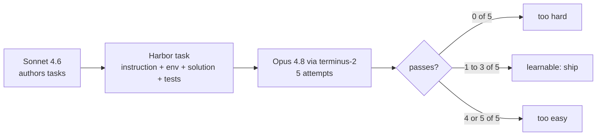
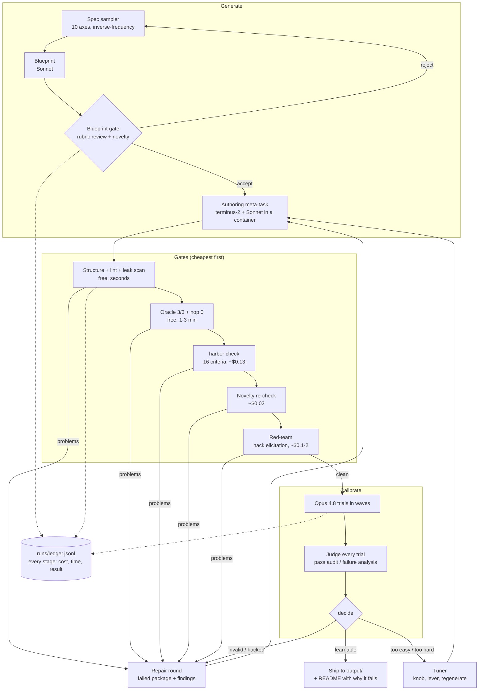
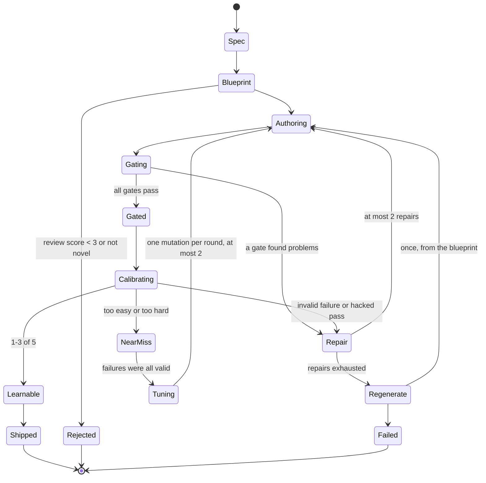
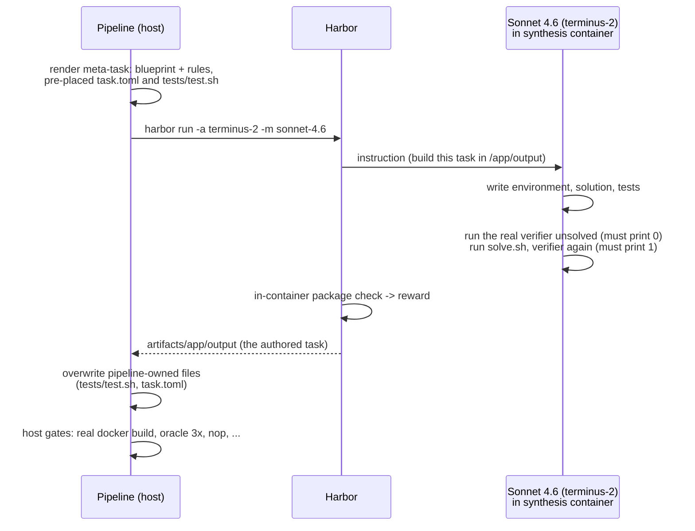
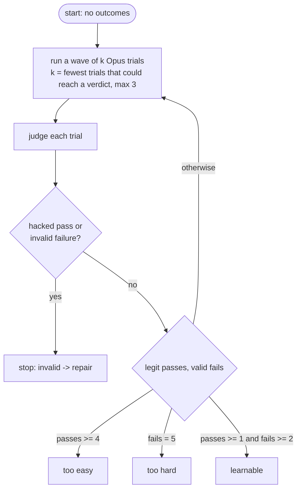
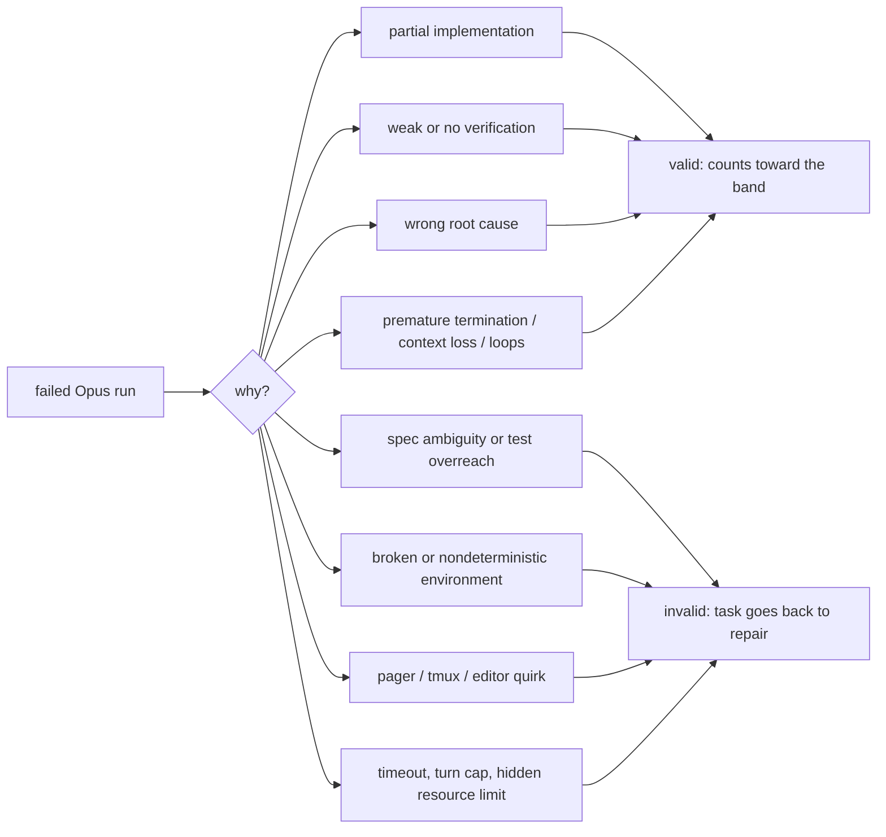
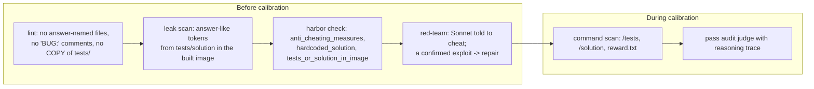
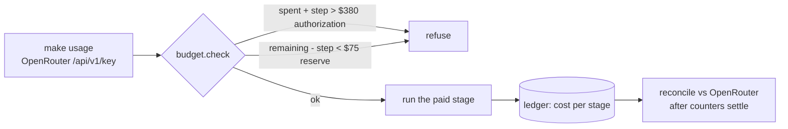
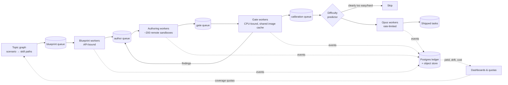
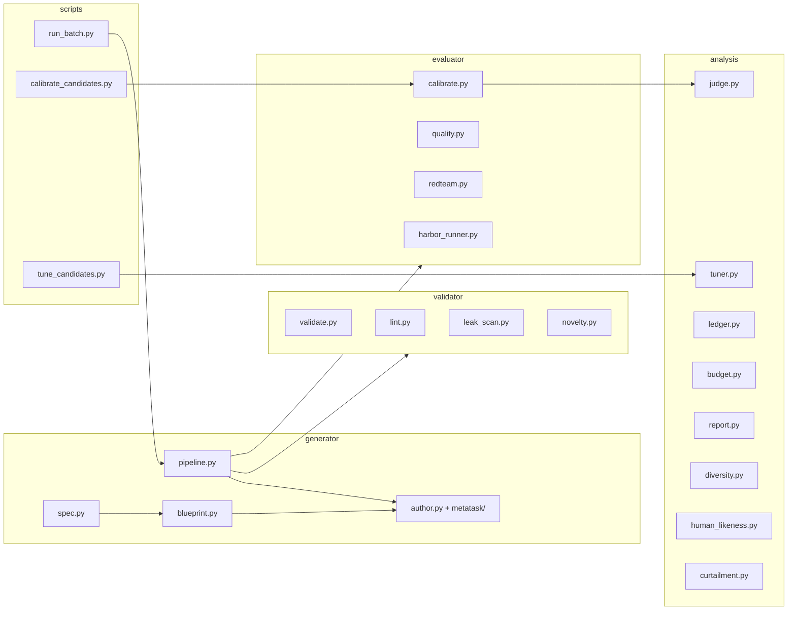

# Architecture, decisions and Q&A

A presentation-oriented guide to the task-generation pipeline. For the full plan and checklist see `docs/plan.md`, for measured Harbor behavior see `docs/harbor-notes.md`, and for the dated log of what changed and why see `CHANGELOG.md`. Numbers here are as of 2026-10-12 and get refreshed from `reports/summary.md`.

## 1. The problem in one picture

AfterQuery wants tasks that sit in a narrow band: run 5 times with `terminus-2` + `claude-opus-4.8`, **exactly 1-3 runs pass**. Tasks are authored by `claude-sonnet-4.6`, and no other models may author or measure difficulty.

"Learnable" is the useful middle: the model sometimes succeeds, so the task gives a training signal (the variance p(1-p) is high; Foster & Foerster 2025).

## 2. System overview

Every arrow is a pure stage over a task directory, recorded in an append-only ledger. The ledger is both the evidence for the report and a cache: a stage whose inputs hash is already recorded doesn't run again.

## 3. Candidate lifecycle

## 4. Authoring as a Harbor task (the "meta-task")

The author is an agent working inside a container, the same way the solver will (Meta-Task, 2026). Harbor collects its output with `artifacts = ["/app/output"]`.

Why the host gates still matter: in Phase 0, the author's self-check ran pytest directly and missed that its `test.sh` called `uvx` without installing it. The real oracle run failed 3/3. `test.sh` and `task.toml` are now pipeline-owned, so no author can get them wrong.

## 5. Calibration: exact curtailment

After 1 pass and 2 fails, at most 5 − 2 = 3 runs can pass, so the 5-run verdict is already certain. **This is lossless.** It's tested on all 32 pass/fail sequences.

| True pass rate p | P(in band) | Expected Opus trials | Saved |
|---|---|---|---|
| 0.2 | 0.67 | 4.05 | 19% |
| 0.35 | 0.83 | 3.85 | 23% |
| 0.5 | 0.78 | 3.94 | 21% |
| 0.8 | 0.26 | 4.32 | 14% |

A tempting extra rule, "reject after 0 passes in the first 3", saves up to 40%, but **loses 19-37% of learnable tasks** at low p. We report it and don't use it.

## 6. What counts as a valid failure

The failure judge reads the instruction, the hidden tests, the verifier output and the agent's trajectory, including its reasoning. It labels the failure with one mode. A "valid" verdict paired with an invalid mode is rejected in code. Harbor-level timeouts and turn-cap endings are always invalid.

## 7. Defense against reward hacking

Why so many layers: Terminal Wrench (2026) found ~17.7% of published terminal tasks hackable, and HVTB found frontier agents read leaked tests or solutions ~31% of the time when they could. The verifier also runs in an isolated `uvx` interpreter, so a solver that patched the system Python can't change test results.

## 8. Budget controls

The cheapest path that proves the code comes first:
1. `make dry-run`: fixtures, no model calls, real gates (free).
2. `DEV_MODE=1`: a cheap dev model (~20-40× cheaper), plumbing only, never shipped or reported.
3. Official models.

## 9. Key decisions

| Decision | Why | Tradeoff |
|---|---|---|
| Author as a Harbor meta-task (an agent in a container) | Grounded in real execution, reuses Harbor's agent, logs and cost tracking (Meta-Task) | No Docker inside the author's container, so the real build and oracle run on the host and feed back through repair |
| Blueprint + review before building | Rejects weak ideas for cents (CLI-Universe drops ~30% at the idea stage) | One extra Sonnet call per candidate (~$0.13) |
| Pipeline-owned `tests/test.sh` and `task.toml` | Phase 0 showed authors get boilerplate wrong (`uvx` missing → oracle 0/3) | Less author freedom, which isn't needed |
| Verify-time `uvx` interpreter | Resists stdlib patching and binary hijacking (Terminal Wrench's exploit classes) | Network + ~5-25 s per verification |
| Oracle must pass 3/3 | Variance from a flaky environment looks "learnable" but isn't (Foster & Foerster's aleatoric caveat) | Two extra free oracle runs per task |
| `harbor check` with a 16-criterion rubric | Catches instruction↔test misalignment, SkillSynth's #1 failure (77%) | ~$0.13 per task. It also blocks 5 of AfterQuery's 6 examples, so it's strict |
| Novelty against 425 published TB tasks + our own | The README forbids reusing or adapting any public task; text overlap alone misses rewording | ~$0.02 per check for the semantic judge |
| Exact curtailment, waves sized to never overshoot | Same verdict as 5 runs, 14-23% fewer trials | Sequential waves take more wall time than 5 at once |
| Judge every trial as it lands; stop on invalid | Don't spend Opus runs on a task that can't ship | ~$0.012 per judged trial |
| Our own judges over `harbor analyze` | Same verdicts on real trials at 1/10 the cost ($0.012 vs $0.13), with structured labels | We maintain the prompts |
| Dev mode with a cheap model | The README's model rule covers generating and benchmarking, not debugging plumbing | Dev runs prove plumbing only; fenced off from shipping and reports |

## 10. Likely questions and answers

**What fraction of generated tasks are learnable?**
See `reports/summary.md` (funnel and pass-count histogram). Literature base rates set expectations: SkillSynth saw ~37% of verified tasks in its band (with 3 tries), and CLI-Universe kept 33.6% of candidates end to end. The first calibrated task was too easy (4/4); the hand review had predicted that.

**How do you know a failure is the model's fault and not the task's?**
Every failing run is judged against the instruction, the hidden tests and the full trajectory, and labelled with one of 10 valid or 6 invalid modes. One invalid failure stops calibration and sends the task to repair. Before that, `harbor check` blocks ambiguity (instruction↔test alignment both ways, determinism, valid failure modes), the oracle must pass 3/3, and the environment can't impose hidden limits (1 CPU / 2 GB is stated in `task.toml`).

**How do you know a pass isn't a hack?**
- Before any Opus run: lint, the leak scan and `harbor check`'s anti-cheating criteria, plus a red-team run where Sonnet is told to cheat. On the first task it couldn't, and solved it honestly instead.
- During calibration: a command scan plus a pass audit with the reasoning trace. A hacked pass invalidates the task.

**Isn't 1-3/5 just noise?**
Partly, yes. A task with true pass rate 0.5 lands in band 78% of the time. That's why variance has to come from the model: oracle 3/3 and deterministic tests rule out environment noise. Shipped tasks can be topped up to a full 5/5 record, and a reproducibility spot-check re-runs one shipped task.

**How did you save money?**
- Every free gate runs before any paid step.
- Exact curtailment cuts 14-23% of trials.
- Calibration stops on the first invalid failure or hacked pass.
- Waves never run a trial that can't change the verdict.
- Authoring summarizes its history past ~60k tokens, and Anthropic prompt caching is on (measured: 96.5% of authoring input tokens are cache reads; output tokens are now ~43% of an authoring run's cost).
- Dry runs and dev mode exist for debugging.
- A $75 reserve is enforced in code.
- Measured costs so far: Opus trial ≈ $0.23, judge ≈ $0.012, `harbor check` ≈ $0.13, blueprint + gate ≈ $0.13. Sonnet authoring cost $2.75 before the cost levers.

**How do you avoid generating the same task over and over?**
- Inverse-frequency sampling over a 10-axis taxonomy (SkillSynth): each value's weight is 1/(count+1)², squared after a 300-seed simulation showed plain 1/(count+1) repeated a domain 3+ times in 18% of 8-task batches (5% squared).
- A novelty gate against published tasks and against our own earlier candidates (in-flight ones by their blueprint). The judge always sees our 2 nearest own tasks, because short outcome-only instructions on the same theme can score cosine ~0.1. It caught 2 of the first 8 blueprints as variants of our own first task: Sonnet drifts back to ledger reconciliation.
- The report shows per-axis balance (exp(H)/N) and a Vendi score. The hand-written examples score Vendi 5.97 of 6, which is the bar.

**Can it adjust difficulty?**
Yes, through the tuner (stretch B). It makes one change per round: first the verifier knob (more or nastier verify-time cases, a stricter *stated* threshold), then a difficulty lever, then regeneration. The change is applied as a repair round, re-gated and recalibrated. It never makes a task easier by weakening the check on its core requirement.

**How close are generated tasks to human-written ones?**
- Same rubric for both sets: the examples score 8-12 of 16 (5 of 6 blocked); the first generated task scored 16/16.
- Stylometrics: instruction length, structure and emphasis.
- A blinded "which one did a human write?" test, where ~50% accuracy means indistinguishable.

Hand review still matters: it found that the first task's instruction named its own bug, which no automated check flagged. The prompts were tightened as a result.

### Throughput and scale

**What limited speed, and what did you do about it?**
The bottleneck was the pipeline's shape, not compute or money. Authoring a task is a 25-45 min Sonnet session whose container idles at ~1% CPU, and batches built one candidate at a time (~2-3 candidates per hour). Changes, each measured or tested:

| Change | Why |
|---|---|
| Candidates build in parallel (`--workers`), with crash-safe claims (`status.json` + pid) | Authoring is API-bound; 2 → 7+ concurrent builds |
| All cheap gates run in one round (static, oracle/nop, quality) | A package used to fail, get repaired, then fail the next gate, one round at a time |
| Novelty → red-team run in parallel with the quality check | ~5-10 min per candidate; the red-team may be paid for and then discarded |
| Authoring cap 80 → 140 turns, repairs capped at 70 | The pilot's first build ran out of turns mid-build; a repair round costs ~$0.9 and ~30 min |
| Toolchain recipes (Rust, Go, Node, C) | Same lines in the authoring image and the task Dockerfile: no turns spent installing toolchains, and builds share Docker's layer cache. Tasks stay self-contained |
| Calibration starts as soon as a task passes its gates | A gated task used to wait for a separate run. A machine-wide slot lock keeps total Opus trials at ≤3 across processes |
| Resume everything after a crash | A reboot mid-run would otherwise have re-sampled specs, re-paid blueprints and restarted calibrations |

Remaining limits: stages within a candidate are sequential on purpose (no Opus spend on a task that might be hackable), and the shared machine caps Opus at 2-3 concurrent trials.

**Could you have gone faster by relaxing the rules?**
Only the rules we set ourselves, and only openly. The README's constraints (Sonnet authors, Opus calibrates, no public tasks, 3600 s timeout, no turn-cap failures counted) are non-negotiable, since a task built around them wouldn't be a valid deliverable. Our own gates are design choices, and every change to them is in `CHANGELOG.md` with the reason.

**What would you change to generate 10,000 gate-approved tasks?**

Rough numbers: at a 40-60% gate yield, ~20k candidates. At ~$4-6 per authored candidate that's ~$100k (less with caching and scaffolding), plus ~$15k of Opus calibration at ~$1-1.5 per task with curtailment. At ~40 min per build, ~200 concurrent sandboxes give ~300 builds/hour, or ~3 days.

| Area | Today | At 10k |
|---|---|---|
| Orchestration | Threads per batch, `status.json` claims | A durable queue per stage, with backpressure, retries and a dead-letter queue. Stages are already idempotent by content hash, so they port as-is |
| Compute | Local Docker, 10 shared CPUs | Remote sandboxes (Harbor supports cloud environments such as Daytona and Modal), with separate pools for API-bound authoring, CPU-bound gates and Opus calibration |
| Images | Every task builds from scratch | Shared base images per language in a registry, a remote BuildKit cache, and pinned package mirrors (which also removes verify-time `uvx` network flakiness) |
| Evidence | JSONL ledger with `flock` | Postgres for events, object storage for packages and trajectories, and dashboards for yield per stage, taxonomy cell and failure mode |
| Rate limits | Not a concern | Token-per-minute budgets per model, adaptive concurrency, and circuit breakers, so one systemic failure (e.g. a broken base image) doesn't burn a thousand builds |

Novelty and diversity become the hard problems at 10k:
- The taxonomy has ~10^5 cells, many of them incoherent, so it needs a richer topic generator. One option is a scenario→skill graph (SkillSynth), whose paths also produce harder tasks.
- All-pairs TF-IDF/n-gram dedup grows quadratically. It would need approximate nearest-neighbour search (MinHash/LSH), with the Sonnet judge only on the nearest few.
- Per-cell quotas stop the generator from piling into the cells it finds easy. We already saw it drift back to ledger tasks.

Quality without hand-reviewing everything: hand-audit a random sample from every N tasks, alert on drift in gate pass rates, hack rates and the failure-mode mix, and re-red-team a sample after any prompt change.

The biggest calibration saving at scale is a difficulty predictor trained on the accumulated calibration records, which skips clearly too-easy or too-hard candidates before any Opus trial. Within this trial it would have to be Sonnet or Opus. We already log the blueprint's predicted pass rate against the observed one to test the idea. Curtailment saves another ~20%, and the band has to be re-calibrated as models improve.

**Why these papers?**
They are the 2026 terminal-task synthesis and evaluation literature: task quality (Bercovich), reward hacking (Terminal Wrench, HVTB), synthesis pipelines (CLI-Universe, Meta-Task, Tmax, SkillSynth) and learnability (Foster & Foerster). Each design decision above cites the one it came from (`docs/research/`).

## 11. Repository map

