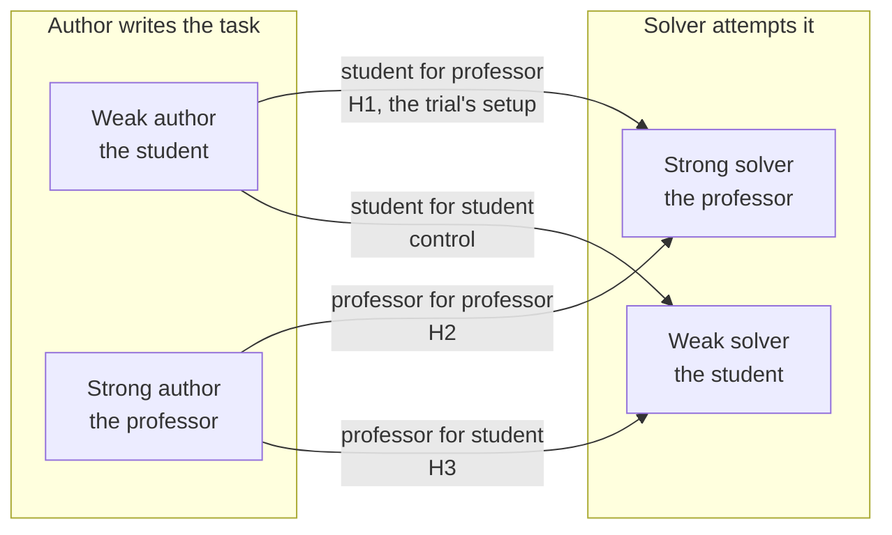

# Who writes the task, who solves it

The reasoning behind the study we are running, what we measured before it, and how it fits the presentation. Numbers here come from `runs/ledger.jsonl`, `runs/candidates/*/calibration.json` and `runs/pilot/pilot_models.json`. Anything not yet measured is marked as a hypothesis.

## 1. The thesis

The work trial asks a **weaker model (Sonnet 4.6)** to write tasks that a **stronger model (Opus 4.8)** solves in only 1 to 3 of 5 runs. That is a student writing problems for a professor of the same field. The professor will usually solve them.

Why it should be hard to beat:
- **The author can't plant what it can't conceive.** A task is only as hard as the author's own competence plus whatever it can build by construction. Whatever the author can write and verify, a stronger model can usually solve.
- **The author holds the answer.** The oracle and the planted defects come from the author, so the solver's problem is "find what the author already knows". Strong solvers are good at finding things in small codebases.
- **A harness can steer the author but not lift its ceiling.** Reviews, levers and tuners change what the author *tries*, not what it is *able* to write.

## 2. What we measured (before the study)

Sonnet 4.6 authored every task below, through a pipeline with a blueprint review, a "speedrun" difficulty review, difficulty levers, a built-package review, a tuner (three kinds of mutation) and a failure judge.

| Task | Opus 4.8 result | Notes |
|---|---|---|
| ledger-reconcile | 4/4, 4/4, 4/4 | original plus 2 tuning rounds adding bugs |
| `2f50` C service | 4/5 | one failure was the agent stopping a service early |
| `31ca` SQL report | 5/5, 5/5, 4/4 | original, tuner round, and a rework with 8 independent hidden-input requirements |
| `3bbd` EMA log fixer | 5/5 | |
| `1091` WAF rule sync | 5/5 | |
| `48eb` config drift | 5/5 | |
| `b540` webpack addon | 5/5 | |
| `8a6e` log pipeline | 0/5 **invalid** | the hidden test expected an order of tied rows the instruction never stated; the failure judge, which first called these valid, now requires an instruction quote |

**9 tasks calibrated, 0 in the 1-3 band.** Passing solves took 4 to 35 turns and every pass audit was legit. Three attempts to make a task harder by tuning (more bugs, lever and knob mutations, 8 independent hidden-input requirements) never moved a pass rate. The only non-pass was a test flaw.

**A cheaper solver does not change the picture.** In a pilot (`scripts/pilot_models.py`, exploratory, nothing shipped or counted), `qwen/qwen3.7-max` solved the same packages 5/5 on every pair finished so far (ledger-reconcile, `2f50`, `31ca`), at $0.32 to $0.61 per 5 trials. So these tasks are not hard for *any* current strong model; Opus is not an outlier. (The pilot is still running; its full table goes in the report.)

Sonnet itself also solved its own ledger-reconcile task in the red-team run.

## 3. The study: three more ways to pair author and solver

Same harness in every case; only the models change. The design is a 2 x 2:

**Proposed models (same family, so the gap is about size and training, not style):**
- weak: `deepseek/deepseek-v4.1-flash` ($0.30 in / $1.20 out per million tokens)
- strong: `deepseek/deepseek-v4-pro` ($0.96 / $1.91)

**Procedure.** About 12 task specs, drawn once and used for both authors, so each author writes a task from the *same* coordinates. Each task goes through the same free checks (structure, lint, leak scan, build, oracle 3/3, nop 0). Every task that passes is then solved 5 times by each solver (so the same task is measured under both solvers). Failures are classified by one fixed judge (Sonnet 4.6) as valid or invalid.

**Metrics per author-solver cell:**
- share of tasks in the 1-3 of 5 band, share too easy (4-5), too hard (0), and invalid;
- mean pass rate and its distribution across tasks;
- share of authored tasks that are valid at all (oracle 3/3, nop 0, no leak): a weak author may simply write more broken tasks;
- cost per task and per in-band task.

**Hypotheses** (to test, not conclusions):
- **H1, student for professor:** most tasks are too easy; few land in the band. Consistent with the 9 tasks above.
- **H2, professor for professor:** a higher in-band share than H1. The author's competence now matches the solver's, so its tasks can sit near the solver's edge.
- **H3, professor for student:** the lowest pass rates; more tasks too hard than in H1 or H2, and a band share that depends on how big the gap is.
- **Control, student for student:** an in-band share between H1 and H2.
- **Ordering:** mean pass rate falls as the author's advantage over the solver grows.

## 4. Threats to validity

- **Small N.** About 12 tasks per author is enough to see a big effect, not a small one. We report counts, not just percentages.
- **"Strong" and "weak" are labels.** We check the gap by solving a common reference set with both solvers; if their pass rates are close, the study can't separate the conditions and we say so.
- **Weak authors write broken tasks.** We report validity separately, so a low band share isn't mistaken for hard-and-valid.
- **One family of models.** Results about DeepSeek flash and pro don't automatically carry to Sonnet and Opus.
- **The band is noisy.** 1-3 of 5 is a coarse estimate of a pass probability; a true 0.5 task falls in it only 78% of the time.
- **Same solver harness (terminus-2, same turn cap)** for both solvers, so differences come from the model.

## 5. How this fits the presentation

1. The trial asks for tasks a stronger model fails most of the time, written by a weaker one: the hardest direction.
2. We built a pipeline with many ways to raise difficulty. None moved the pass rate. The reason is not a missing gate: it is who is writing and who is solving.
3. We tested the claim: swapping the pairing, with the same harness, shows where learnable tasks come from.
4. What this implies for a real task-generation pipeline: generate with a model at least as strong as the target solver, or find a source of difficulty that does not depend on the author out-thinking the solver (long-horizon work, search, large inputs, verification that is cheap while solving is hard).

Whatever the outcome, the study gives a measured answer rather than a claim.

## 6. Measured outcome: luna author, gpt-5.4-mini solver (the shipped run)

Full report: `reports/summary.md`; shipped tasks: `output/`. Novelty reference for this run is TB 2.1 plus `examples/` only (`NOVELTY_SETS=terminal-bench-2-1`).

- **Models:** `openai/gpt-5.6-luna` authors, reviews, judges and red-teams; `openai/gpt-5.4-mini` (about 60% on TB 2) calibrates. The band is relative to mini.
- **Three tasks shipped, the trial's first:** `repair-log-replay-sql` (1 pass / 2 valid fails of 3), `optimize-policy-decision-audit` (3/5), `repair-attributed-funnel-service` (3/5). Every one re-verified with `scripts/validate.sh`, an independent `harbor run` oracle 3/3 and nop 0. (The live ledger shows 2 learnable because the still-running batch re-authored the first task's source candidate after it shipped; the third task's calibration record is in its output README.)
- **Funnel for this model label (22 candidates):** 21 blueprint-accepted, 21 authored, 20 structurally valid, 21 functionally correct, 4 quality-ok, 19 novel, 17 red-team clean, 13 calibrated, 2 learnable in the live ledger (3 shipped in total). Model cost ≈ $10.4 and ≈ 604 stage-minutes.
- **The distribution is bimodal, not centred on the band:** of 13 calibrated, learnable 2, too_easy 1 (4/4), too_hard 6 (0/5), invalid 4 (mostly `test_overreach`, a test checking behavior the instruction never states). A weaker solver added both passes and hard failures; it did not simply move tasks into the band, and a quarter of the calibrated tasks were invalid for instruction/test misalignment.
- **Comparison:** Sonnet 4.6 -> Opus 4.8 gave 0 of 9; luna -> luna gave 0 shipped of ~8 (4 at 0/5, 1 at 4/4). luna -> mini gave 3 shipped. The same-brand weaker solver helped at the margin, but the first-order limit is task construction and the quality/repair loop, not the pairing.

## 7. Threats to validity, as measured

Small N (4 valid tasks), one family, mixed repair policy (1 vs 3 repairs, flagged), the weak solver's turn-cap failures counted invalid, one judge, no pass audit, a gap check run on 3 of 5 packages (a spend-guard bug stopped it; fixed afterwards, not rerun), and one weak spec unfinished at the deadline.

## 8. Status

See "Study: who writes the task, who solves it" in `docs/plan.md`.
