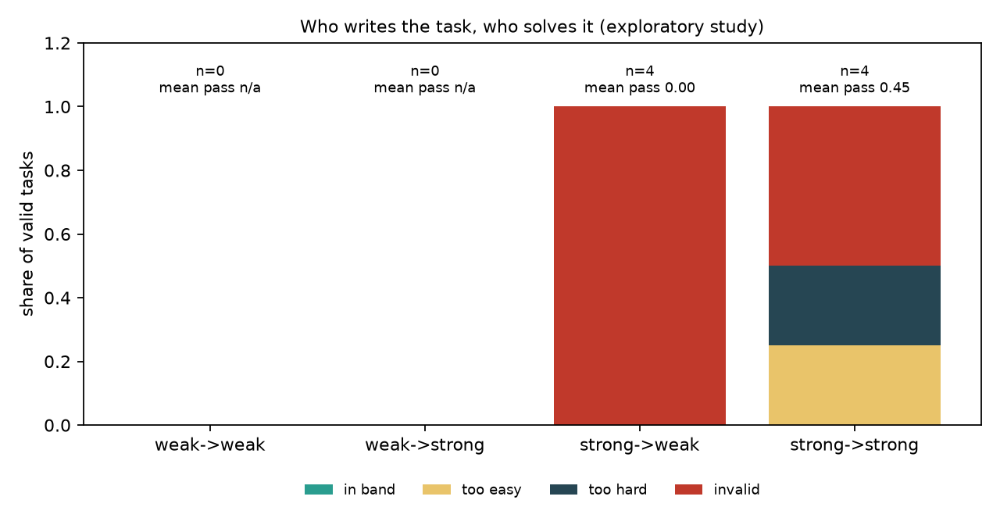

# Who writes the task, who solves it: an exploratory 2 x 2 study of author and solver strength in Terminal-Bench task generation

*Exploratory study, a user-approved deviation from the work trial's model rules. Nothing here is shipped or counted in the trial's funnel. Every number comes from `runs/study/results.json`, `runs/study/gap.json`, `runs/study-deepseek-partial/` or `runs/ledger.jsonl` (events with `mode == "study"`).*

## Abstract

The work trial asks a weaker model (Sonnet 4.6) to write tasks that a stronger model (Opus 4.8) solves in 1 to 3 of 5 runs. After 9 calibrated tasks, none was in that band (8 too easy, 1 invalid). We tested one explanation: a weaker author writing for a stronger solver is a student writing problems for a professor. With the same harness and only the models changed, we paired a weak and a strong author with a weak and a strong solver, all from the Gemini family (`gemini-2.5-flash-lite`, `gemini-3-flash-preview`). Eight specs were drawn once; each author wrote a task from the same spec, tasks passed free gates (structure, lint, leak scan, build, oracle 3/3, nop 0), and each valid task was solved 5 times by each solver. **The thesis could not be tested as designed: the weak author produced 0 valid tasks of 7 (the strong author 4 of 8), so the weak-author cells are empty.** Among the strong author's 4 valid tasks, none landed in the 1-3/5 band: the strong solver scored 4/5, 0/5, 5/5 and 0/5, and the weak solver 0/5 on all four (with many turn-cap failures counted invalid). The solver gap is real (5/5 vs 0/5 and 4/5 vs 0/5 on pilot packages), but the data are too small to support or reject the thesis. Total ledger-recorded spend was $16.38.

## 1. Introduction and thesis

Terminal-Bench style tasks are useful for training when the solver sometimes passes: the variance p(1-p) bounds the expected learning signal (Foster and Foerster, arXiv 2502.12272). The trial's band, 1 to 3 of 5 passes, targets that region. Our pipeline (blueprint review, difficulty levers, a built-package review, a tuner with three kinds of mutation, a failure judge) calibrated 9 Sonnet-authored tasks against Opus 4.8 with none in the band (`docs/findings.md`); a Qwen pilot solved the same packages 5/5, so Opus was not an outlier.

**Thesis.** The author cannot plant difficulty beyond what it can conceive and verify, it holds the answer, and a harness steers what it tries rather than what it can write. So weak author -> strong solver should give mostly easy tasks, while a stronger author should reach the band more often. This is a hypothesis about the trial's own setup; we test it in a controlled 2 x 2.

## 2. Related work

The design follows the task-synthesis literature in `docs/research/`: blueprints before building and role separation (CLI-Universe, 2606.22883), authoring as a Harbor meta-task (Meta-Task, 2607.27929), planner/constructor splits and repair limits (SkillSynth, 2604.25727), verifier kinds as difficulty knobs (Tmax, 2606.23321), task-quality rules (Bercovich, 2604.28093), and hack-resistance checks (Terminal Wrench, 2604.17596; HVTB, 2608.22103). None of these varies the author's strength against the solver's while holding the harness fixed, which is what we do here.

## 3. Method

**Design.** Author in {weak, strong} x solver in {weak, strong}. The same 8 specs (`generator.spec.sample_specs`, seed 2026) go to both authors, who write a blueprint and then a package through the same authoring meta-task (`generator/author.py`), with the same prompts.

**Models.** Weak: `google/gemini-2.5-flash-lite`. Strong: `google/gemini-3-flash-preview`. Judge: Sonnet 4.6 (`analysis/judge.analyze_failure`), the same for every trial. An earlier pair (`deepseek-v4.1-flash` / `deepseek-v4-pro`) was abandoned: flash spent 12-27k hidden reasoning tokens per authoring step (3-6 min per step). Its partial evidence is in `runs/study-deepseek-partial/` and is not part of the results.

**Gates (free).** Structure, lint, leak scan, Docker build, oracle 3/3 and nop 0 (`generator.pipeline.gate_static` and `gate_functional`). A failed gate feeds a repair round of the meta-task; the policy was up to 3 repairs, but tasks that were already finished under the first, shorter policy keep that outcome (1 repair) and are flagged in `results.json`. A package too incomplete to scan (no `instruction.md`) is an invalid task.

**Solving.** Each valid task is solved 5 times per solver with plain terminus-2 (`attempts=5, concurrent=3, max_turns=100`). Each failure is classified valid or invalid by the fixed judge, which must quote an instruction requirement for a failure to be valid. Reaching the turn cap counts invalid.

**Metrics** (`analysis/study.py`). Per cell: verdict shares (in band 1-3/5, too easy 4-5, too hard 0, invalid; any invalid failure voids a task's verdict), mean pass rate, pass-count histogram, validity rate and cost. The raw band (pass counts alone) is also reported.

**Gap check.** Both solvers on 5 pilot packages that Opus solved 4/4 to 5/5.

## 4. Results

### 4.1 The solvers differ

| Package | Opus 4.8 | weak solver | strong solver |
|---|---|---|---|
| ledger-reconcile | 4/4 | 0/5 (3 invalid) | 5/5 |
| `2f50` | 4/5 | 0/5 (1 invalid) | 4/5 |
| `31ca` | 4/4 | 2/5 (1 invalid) | 5/5 |
| `b540`, `3bbd` | 5/5 | not run | not run |

Only 6 of 10 gap jobs ran: the gap command used an $8 guard compared with the whole study's spend and stopped early (a bug, fixed afterwards; a rerun finished one more job before the deadline). Where both ran, strong beat weak clearly. In the DeepSeek attempt, flash had solved the same packages 5/5, 5/5 and 2/5, so Gemini flash-lite is a much weaker solver than DeepSeek flash.

### 4.2 Author validity

| Author | Specs completed | Passed every free gate | Valid on the first try |
|---|---|---|---|
| weak | 7 (spec 02 unfinished) | **0** | 0 |
| strong | 8 | **4** | 2 |

Weak-author packages failed on missing `solution/` or `instruction.md`, missing canary text, or an oracle that did not pass. The strong author's failures were an oversize environment (94 MB), suggestive comments (a lint rule), and an oracle failing 0/3 twice. Author cost: weak $2.01, strong $1.80 (study ledger).

### 4.3 Cells

| Author -> solver | Valid tasks | In band | Too easy | Too hard | Invalid | Mean pass rate | Pass counts 0..5 |
|---|---|---|---|---|---|---|---|
| weak -> weak | 0/7 | 0 | 0 | 0 | 0 | n/a | n/a |
| weak -> strong | 0/7 | 0 | 0 | 0 | 0 | n/a | n/a |
| strong -> weak | 4/8 | 0 | 0 | 0 | 4 | 0.00 | [4,0,0,0,0,0] |
| strong -> strong | 4/8 | 0 | 1 | 1 | 2 | 0.45 | [2,0,0,0,1,1] |

Raw bands (pass counts only): strong -> weak: 4 too hard; strong -> strong: 2 too easy, 2 too hard. Per task (strong solver / weak solver passes): task 02: 4/0, task 03: 0/0, task 05: 5/0, task 07: 0/0.

### 4.4 What the failure judge said

- Strong solver, task 02: 4 passes and 1 failure labelled `test_overreach` (invalid), so the task is voided; task 03: 0 passes with 2 invalid trials (turn cap), `capability_gap`, `partial_implementation`, `repetition_loop`; task 07: 0/5, all valid (`weak_verification` 3, `wrong_root_cause` 1, `capability_gap` 1), a candidate in-band task that was simply too hard for this solver.
- Weak solver: 0 passes everywhere, with 2-3 trials per task reaching the 100-turn cap (invalid), and `repetition_loop`, `premature_termination` and one `environment_broken` among the failures.

### 4.5 Cost

Ledger-recorded study spend: $16.38 (blueprints $0.57, authoring $7.54, solving $8.27; gates are free). The key's usage rose by about $33.6 over the window, which also covers the end of the solver pilot (capped at $6), killed DeepSeek jobs and calls the ledger could not price. Both are within the $40 study cap and the $400 account ceiling (key spend at the end: $173.21 of $500).

## 5. Discussion

**Does the thesis hold?** Not tested, and not supported by this data. The weak-author -> strong-solver cell, the trial's own setup, is empty because the weak author never produced a valid package. What the data do show is a different, earlier effect: author strength decided whether a task existed at all (0/7 vs 4/8) before it could decide difficulty, and our free gates caught every broken weak package without any model cost. For the strong author, the 4 valid tasks gave strong-solver pass counts of 4, 0, 5 and 0: spread to both extremes, none in the band, which echoes the bimodality that Tmax reports for pools without difficulty control. Four tasks is too few to say whether that is a property of the author or of luck.

**Mechanisms.** (1) A flash-lite author often lacked the discipline to produce a full Harbor package (files and directories missing), which is a capability gap on the author side before it is a difficulty one. (2) The weak solver mostly fails by looping or hitting the turn cap, so its "too hard" is noise for band purposes, which is why its verdicts are invalid. (3) Task 07 shows a valid, hard task (0/5 with substantive failures) and task 05 a trivial one (5/5 in 5-8 turns), as the thesis would predict for different authors, but both are from the same author.

## 6. Threats to validity

- **Small N.** 8 specs, 4 valid strong-author tasks, 0 valid weak-author tasks.
- **One model family**, and the model labels weak and strong are ours; the gap check ran on only 3 of 5 packages.
- **Late weak-author rerun (3 repairs, started at 05:27) did not finish before the 06:00 deadline and was stopped; the weak outcomes shown are the 1-repair ones.** **Mixed repair policy:** some tasks got 1 repair and some 3 (flagged in `results.json`); the weak author may be penalised or helped by that, and 1 weak spec (02) was unfinished at the deadline and is excluded.
- **A gate crash in the first version of the study code** hit one weak package without an `instruction.md`; it was recorded as invalid (as it is).
- **Solver turn caps.** At `max_turns=100` the weak solver's failures are largely invalid by our own rule, which empties its cells' band shares.
- **Judge bias.** One Sonnet 4.6 judge classified all failures, and we did not run a pass audit on study passes (cheap, but skipped for time).
- **Pilot vs study.** The pilot packages were authored by Sonnet and solved with a 100-turn cap, like the study, but with different models.
- **Abandoned DeepSeek run.** Its partial data (3 of 8 weak blueprints failed to parse; flash gap results) are limitations, not results.
- **Cost accounting.** The ledger under-counts unpriced calls, so the key's own delta ($33.6) is the upper bound.

## 7. Conclusion and implications

We could not confirm or reject the thesis; the data say the weak author failed at a more basic step than difficulty. For the trial's pipeline this is consistent with the structure we built: gates before spend. The next steps are a larger run (more specs per author, matched repair budgets), a weak author closer in strength to the strong one so that its packages are valid, a pass audit for study passes, and then the transfer check with Opus 4.8 on any in-band task. Until then, the claim "a weaker author caps task difficulty" stays a hypothesis supported by the trial's own 0 of 9 band results, not by this study.

## Reproduce

`uv run --env-file .env python -m scripts.study run --specs 8` (resumable), `... gap`, `... summary`, then `uv run python -m analysis.study_figure`. The deck is built with `node docs/build_deck.js` from `runs/study/results.json` and `docs/study-answer.json`.
